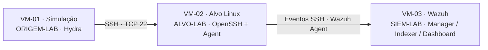

# Do NOC ao SOC — Detecção SSH com Wazuh

**Autor:** Luccas M. Possatti · **Natureza:** laboratório controlado · **Revisão documental:** 05/11/2026

Um exercício de segurança defensiva que conecta infraestrutura, análise de logs e gestão de riscos. O objetivo foi reconhecer tentativas de senha SSH, entender a correlação do Wazuh e produzir uma investigação rastreável.

## Resultado

O alerta histórico de **10/09/2026**, **regra 5763, nível 10**, apresenta a composição de oito falhas SSH da mesma origem: sete eventos anteriores e o evento atual, conforme E35. A sequência visível vai de **20:26:57 a 20:27:20 UTC**, aproximadamente 23 segundos. Os sete primeiros horários são reconstituídos do `previous_output` em E26/E35; o último também aparece em E24. O alerta tem timestamp **20:27:21.468 UTC**.

Não foi observado login bem-sucedido nos trechos analisados do evento. O experimento usou senhas deliberadamente inválidas e não testou prevenção, bloqueio automático ou resistência da senha real. A investigação não constitui uma comprovação abrangente de ausência de comprometimento.

| Ambiente | Atividade observada | Resultado |
|---|---|---|
| 3 VMs Linux | 8 falhas SSH de uma origem | 1 alerta de correlação 5763, nível 10 |

**[Consultar o extrato público do alerta e a sequência correlacionada](docs/evidence-excerpts.md#e35--correlação-de-falhas).**

Os extratos públicos preservam contagens, horários e interpretação técnica. Identificadores do ambiente foram substituídos por rótulos; os registros originais permanecem privados.

## Arquitetura

| Máquina | Papel | Evidência / limite |
|---|---|---|
| VM-01 | Origem da simulação | E36 registra os comandos do Hydra |
| VM-02 | Serviço SSH monitorado | E24 mostra eventos; E37 mostra configuração posterior |
| VM-03 | Análise e visualização | E35 mostra a correlação; E27 registra timestamp e nível |

O exercício usou uma rede virtual de laboratório. Os nomes ORIGEM-LAB, ALVO-LAB, SIEM-LAB e CONTA-LAB são rótulos de anonimização, não endereços nem contas utilizáveis. A revisão operacional de segurança é mantida em arquivo privado; a publicação descreve apenas seu escopo e seus limites.

## Como a investigação foi conduzida

**Janela A e Janela B são rótulos de cenários, não uma ordem temporal.** O evento de 10/09 antecede a comparação de 27/09.

1. Comparação com autenticações legítimas na Janela A, coletada em **27/09/2026**. Apesar do nome, essa janela foi registrada depois do ataque.
2. Análise da sequência de falhas SSH da Janela B, em **10/09/2026**.
3. Reconciliação de eventos individuais 5760 com o alerta de correlação 5763.
4. Conferência de logs de autenticação e histórico de sessões `last -i`.
5. Registro de limitações, riscos e tratamentos propostos.

E36 registra uma sequência de oito comandos Hydra e uma tentativa avulsa anterior. O histórico não contém timestamps; a tentativa avulsa não foi somada ao evento, e o vínculo dos comandos com a Janela B depende do contexto documentado, não de uma identificação da ferramenta pelos logs SSH.

## O que cada regra representa

| Regra | Papel neste exercício |
|---|---|
| 5715 | Autenticação SSH aceita; os cinco eventos da comparação legítima aparecem em E30 |
| 5760 | Falha individual de autenticação; a consulta de suporte contém sete eventos do ataque e um anterior |
| 5763 | Correlação de falhas da mesma origem; configuração consultada: `frequency=8`, `timeframe=120`, `ignore=60` |

No conjunto examinado, a regra 5760 contém o mapeamento **T1110.001**; a regra 5763 contém **T1110**. Metadados de uma regra não comprovam uso de uma ferramenta nem sucesso do ataque. Fontes e limites estão no [mapeamento de controles](docs/control-mapping.md).

## Documentação

| Documento | Conteúdo |
|---|---|
| [Relatório SOC](docs/incident-report.md) | Timeline, fontes, hipóteses e conclusões |
| [Riscos e controles](docs/fase11-grc-risco-controles.md) | Matriz 5×5 e tratamento proposto |
| [Mapeamento de referenciais](docs/control-mapping.md) | Relação com ATT&CK, NIST e CIS |
| [Índice de evidências](docs/evidence-index.md) | Arquivos, datas, escopo e integridade |
| [Extratos públicos](docs/evidence-excerpts.md) | Transcrições analíticas anonimizadas das fontes examinadas |
| [Revisão e aprendizados](docs/lessons-learned.md) | Correções técnicas e limitações |
| [Verificação de segurança](docs/security-hygiene.md) | Conferências feitas e verificações restantes |
| [Roteiro de reprodução](docs/reproduction.md) | Pré-requisitos e critérios para uma nova execução |

## Limites do resultado

- Uma execução controlada, uma conta e um par origem/alvo; sem medidas de eficácia em produção.
- E32 é citada no histórico, mas não foi localizada no acervo recebido. A sequência pública se apoia em E26/E35/E24; não reproduz a precisão de microssegundos atribuída à E32.
- Os alertas exibem `location: journald`. Wazuh e `auth.log` representam o mesmo serviço SSH, não duas observações independentes do comportamento.
- A comparação legítima não mede taxa de falsos positivos. A diferença nominal entre timestamps não é uma medida de MTTD.
- Esta edição pública contém extratos analíticos anonimizados. Screenshots, logs brutos e configurações operacionais não integram a publicação.
- Os riscos e mapeamentos são uma análise de laboratório, sem declaração de conformidade ou certificação.

## Privacidade e rastreabilidade

Usuários locais, endereços do ambiente e identificadores operacionais foram omitidos. As fontes originais e a auditoria de segurança permanecem privadas. Os extratos são transcrições analíticas identificadas como tal; não são exports nativos nem substituem uma cadeia de custódia forense.

Este estudo demonstra análise e documentação. As recomendações de endurecimento permanecem propostas, com validação futura necessária.
